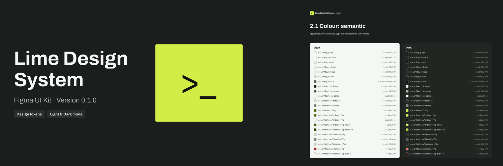

<p>
<picture>
  <source media="(prefers-color-scheme: dark)" srcset="docs/media/readme/banner-dark.svg">
  
</picture>
</p>

<p>
<picture>
  <source media="(prefers-color-scheme: dark)" srcset="docs/media/readme/tags-dark.svg">
  
</picture>
</p>

The design system for [Lime](https://github.com/classiccosta/lime-local-ai), a local-first chat client. Colour, type, spacing and radius are defined once as tokens in Figma, checked for accessibility, and exported as platform-neutral JSON that web, iOS and Android builds can consume. The hard part of a design system is keeping Figma and code in step. This repo automates and tests that step.

<p><a href="https://www.figma.com/community/file/1705316793159745808"><picture><source media="(prefers-color-scheme: dark)" srcset="docs/media/readme/figma-dark.svg"></picture></a></p>



## What's inside

- **Figma UI Kit:** Cover, Overview (tiers, naming, do and don't), Library (colour, typography, spacing, radius, token reference).
- **Variables:** Primitives, Theme/Light, Theme/Dark, Layout. Semantic tokens alias primitives.
- **Text styles:** 6, bound to variables.
- **Themes:** light and dark, identical token names.
- **Tokens:** 5 DTCG 2025.10 files in `tokens/`.

## How it works


In production, designers edit Figma and a sync tool (plugin or API) writes the JSON. The Figma free plan has no sync, and its own export drops alias references, so this repo flips the flow: `scripts/token-source.js` is the source, `npm run build` writes `tokens/*.json`, and Figma is mirrored by hand. Style Dictionary, platform outputs, CI and releases are the next stage.

**Today:** validated DTCG JSON, checked against Figma. **Stage 1:** CSS, Swift and Kotlin built from it with Style Dictionary, tested in CI, with a live demo.

```bash
npm run build     # token-source.js → tokens/*.json, then validate
npm run compare   # tokens/ vs a fresh Figma export
```

Edit values in `scripts/token-source.js` only. `tokens/*.json` are generated. Rules for when Figma changes: [`docs/token-pipeline.md`](docs/token-pipeline.md).

## Tests

`npm run build` exits with an error when:

- a semantic token does not alias a primitive, or has no description
- Light and Dark token names differ
- a text style references a missing primitive
- a text, UI or focus pair misses WCAG 2.2 AA (4.5:1 text, 3:1 UI and focus), in either theme

`npm run compare` exits with an error when `tokens/` and Figma's export disagree on a value, alias, description, code syntax or scope.

## Docs

- [`docs/token-pipeline.md`](docs/token-pipeline.md): token flow and the update rule
- [`docs/figma-conventions.md`](docs/figma-conventions.md): how the Figma file is organised
- [`docs/figma-plan-limits.md`](docs/figma-plan-limits.md): free-plan limits and workarounds
- [`docs/audit/AUDIT.md`](docs/audit/AUDIT.md): Lime before, and what we decided
- [`docs/prd/`](docs/prd/): Stage 0 and 1 requirements
