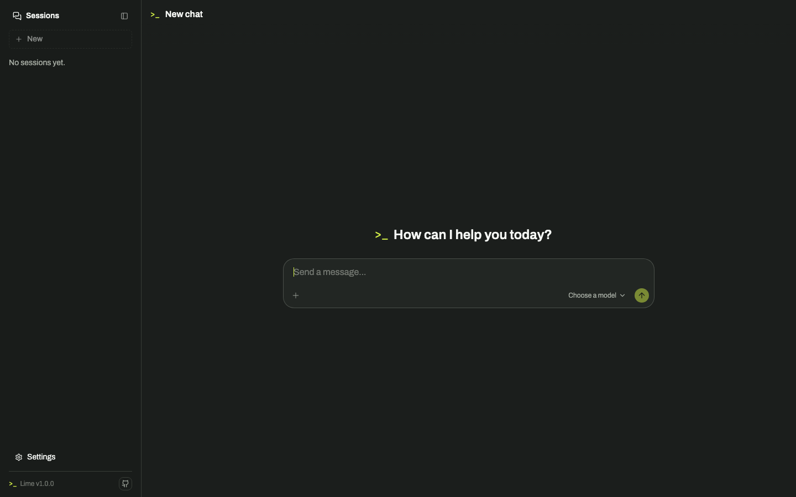

# Lime audit

What Lime's styles looked like before this project (`AI-chat`, commit `fb10654`). Numbers were measured with a local audit script that scans Lime's source; the script and its raw output are kept private and are not in this repo.

## In numbers

| | |
|---|---|
| Colour tokens | **32, but only 14 distinct values** |
| Near-identical colours (ΔE < 5) | 10 pairs |
| Hard-coded colours outside the token block | 0 |
| Palette classes that bypass the tokens | 9 (mostly black/white overlays) |
| Light theme | none, the app is dark only |
| Contrast failures (WCAG AA) | 4 of 22 pairs, all borders (about 1.5:1, need 3:1) |
| Radius classes in use | 20, against 7 derived steps |
| Spacing steps off a 4px scale | 25 |

## What we found

1. Token names describe slots (`secondary`, `accent`), not purpose, and many share one value.
2. Several greys are indistinguishable (ΔE 1 to 2).
3. Borders fail contrast. Text, focus and primary pass comfortably.
4. Only a dark theme exists.
5. Overlays are black/white alpha classes in the markup, with no token behind them.
6. Spacing really runs on a 2px grid (6px is used 44 times).
7. Generated shadcn and assistant-ui code holds most of the drift, so fixes belong in the tokens.

## What we decided

All of this is built in the Figma file.

- **Colours:** merge near-identical greys, drop unused `sidebar-*` and `chart-*`, and name by purpose. The result is 18 semantic colour tokens, aliasing a shared primitive layer.
- **New tokens:** `border/strong` (passes 3:1), `bg/scrim`, `feedback/error/bg-subtle`.
- **Light theme:** designed from scratch with its own values, not an inversion. A darker lime is the action and focus colour on light backgrounds.
- **Spacing:** `0, 2, 4, 6, 8, 12, 16, 24, 32, 48`. 10px and 14px are not kept; they map to 8 or 12.
- **Radius:** five steps by purpose: `sm`, `md`, `lg`, `xl`, `full`.
- **Type:** keep Lime's six sizes (12 to 24). Their ratio is about 1.15, nearest named ratio 1.125.
